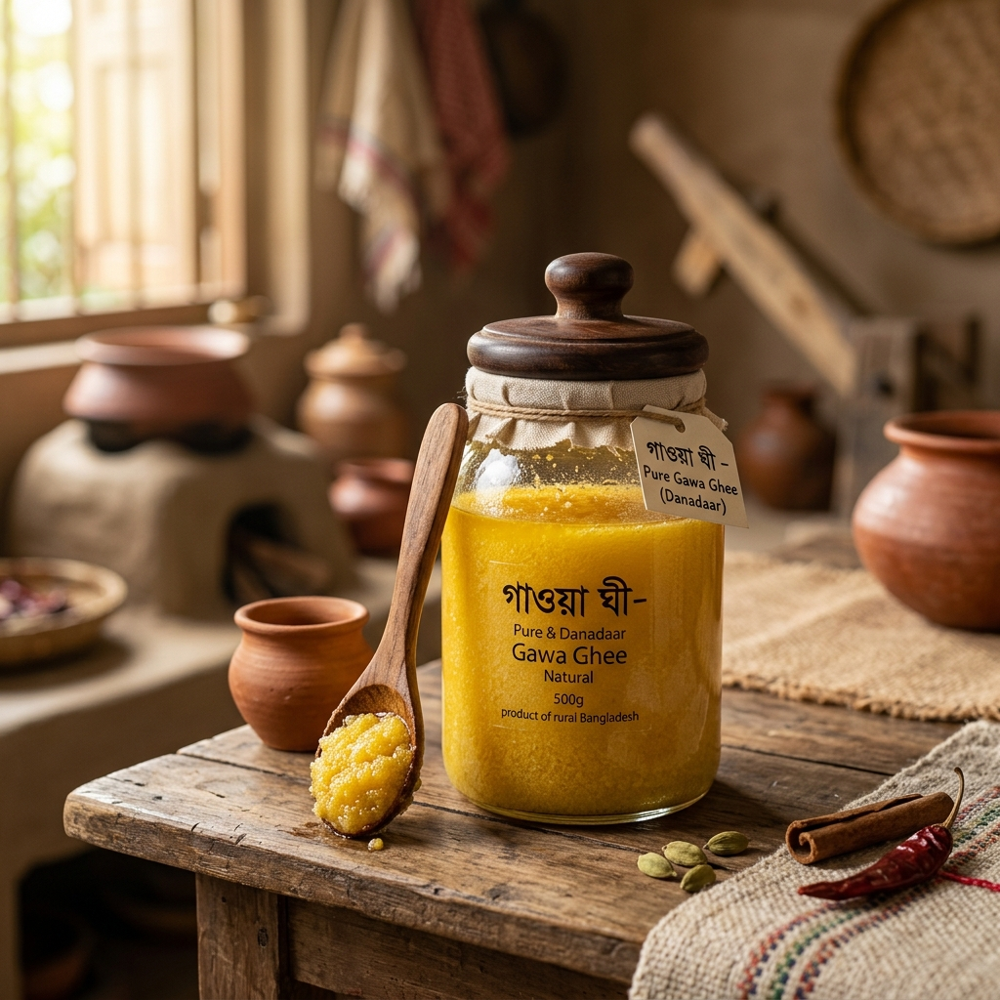

# TASNEEM BD (tasneembd.com)

> **খাঁটি প্রাকৃতিক খাদ্য, ঐতিহ্য ও সুন্নাহ লাইফস্টাইল ই-কমার্স প্ল্যাটফর্ম**



## 🌿 প্রজেক্ট পরিচিতি (About Project)
**TASNEEM BD** (`tasneembd.com`) বাংলাদেশের একটি প্রিমিয়াম প্রাকৃতিক খাদ্য ও সুন্নাহ লাইফস্টাইল ই-কমার্স প্ল্যাটফর্ম। 

### 📍 আমাদের মূল পণ্য ও নিজস্ব আঞ্চলিক উৎস (Authentic Sourcing):
* 🧈 **সাতক্ষীরার খাঁটি গাওয়া ঘি:** সাতক্ষীরা সদর ও শ্যামনগরের দেশি গাভীর দুধ থেকে কাঠের আগুনে জ্বাল দিয়ে প্রস্তুতকৃত দানাদার গাওয়া ঘি।
* 🥭 **সাতক্ষীরার রসালো হিমসাগর আম:** কলারোয়া ও দেবহাটার বালাইনাশকমুক্ত, ক্যালসিয়াম কার্বাইডমুক্ত গাছপাকা হিমসাগর আম।
* 🍯 **সুন্দরবনের খাঁটি র' খলিশা মধু:** বুড়িগোয়ালিনী রেঞ্জ, সুন্দরবন (সাতক্ষীরা) থেকে সংগৃহীত কাঁচা ও আনপ্রসেসড মধু।
* 🌴 **সৌদি আরবের আজওয়া ও সুক্কারি খেজুর:** পবিত্র মদিনা মোনাওয়ারা ও আল-কাসিম থেকে সরাসরি আমদানিকৃত প্রিমিয়াম ভিআইপি খেজুর।
* 👑 **মদিনা ও দুবাইয়ের রাজকীয় আতর:** ১০০% অ্যালকোহলমুক্ত হালাল সুগন্ধি ও কাবা কিসওয়া আতর।
* 🍃 **সিলেটের শ্রীমঙ্গলের ক্লোন কুঁড়ি চা ও পাহাড়ি তেজপাতা:** শ্রীমঙ্গলের বিশ্বখ্যাত বাগান থেকে তাজা প্রথম চয়ন।
* 🌶️ **খাঁটি দেশি মশলা:** বগুড়ার লাল মরিচ, দেশি গুঁড়া হলুদ ও গুঁড়া ধনিয়া।
* 🕌 **ইসলামিক লাইফস্টাইল:** তুর্কি মেমরি-ফোম অর্থোপেডিক জায়নামাজ ও প্রাকৃতিক জয়তুন মেসওয়াক।

---

## 🚀 টেকনোলজি স্ট্যাক (Tech Stack)
* **Frontend:** React 18, Vite 6
* **Icons:** Lucide React
* **Effects:** Canvas Confetti
* **Design:** Custom Modern Glassmorphic CSS with Hind Siliguri & Plus Jakarta Sans typography
* **Deployment Ready:** Vercel, Netlify, GitHub Pages

---

## 🛠️ লোকাল সেটআপ ও রান (Local Setup & Run)

```bash
# ডিপেন্ডেন্সি ইন্সটল করুন
npm install

# লোকাল ডেভেলপমেন্ট সার্ভার চালু করুন
npm run dev

# প্রোডাকশন বিল্ড তৈরি করুন
npm run build
```

---

## 📞 হটলাইন ও যোগাযোগ
* **হটলাইন / হোয়াটসঅ্যাপ:** `01714-740430`
* **ডোমেইন:** `tasneembd.com`
* **ঠিকানা:** বাড়ি ১২, রোড ৫, বনানী, ঢাকা - ১২১৩
